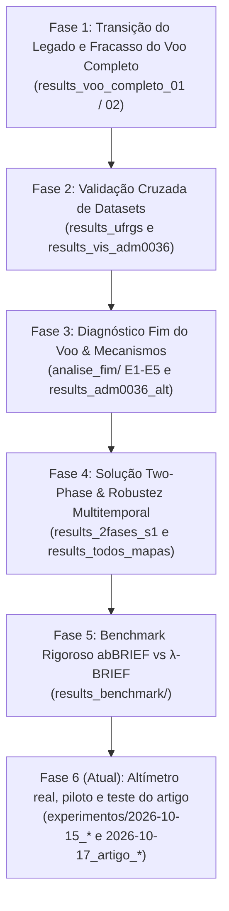

# Histórico e Catálogo de Resultados Experimentais — λ-BRIEF & abBRIEF

Este documento registra a evolução cronológica, hipóteses, configurações e conclusões de cada bateria de testes executada na engine moderna (`lambda_brief_modern/`). Ele funciona como um diário de bordo científico e deve ser atualizado a cada nova rodada experimental conforme as diretrizes do [`AGENTS.md`](file:///home/vitor-ochoa/Storage/UAVs%20Localization/AGENTS.md).

---

## 1. A Linha do Tempo Experimental (A História dos Resultados)

A jornada experimental na engine moderna passou por seis fases principais:

1. **Fase 1 (Início de Setembro/2026): A Falha da Inicialização Uniforme.**  
   Ao migrar para o C++17, os testes iniciais de localização global no voo completo ADM2 falharam dramaticamente (erros > 400 m). Descobriu-se que, sem injeção de hipóteses ou prior de altímetro, a probabilidade de uma partícula cair na bacia estreita do Ground Truth era ínfima, gerando modos espúrios em escalas pequenas.
2. **Fase 2 (Meados de Setembro/2026): O Enigma da Semente 42.**  
   No dataset da UFRGS e no ADM2 com seed 42 (`results_vis_adm0036`), o filtro convergiu com precisão submétrica/decamétrica (~15 m). A reprodução do artigo funcionava, mas dependia criticamente do acaso da semente inicial.
3. **Fase 3 (Fim de Setembro/2026): A Dissecação Científica (`analise_fim`).**  
   Adicionar priors de altímetro e injeção aleatória acelerou a convergência inicial para quase todas as sementes, mas causou um efeito colateral inesperado: o filtro perdia o rastro sistematicamente na manobra de pouso final (10 de 10 execuções). Foi realizada a bateria controlada de 29 experimentos (E1 a E5) que provou que priors rígidos e injeção contínua desestabilizam o rastreio fino quando o drone desce e curva.
4. **Fase 4 (Virada de Outubro/2026): O Filtro em Duas Fases (`--two_phase`).**  
   Desenvolveu-se o controlador de transição de fase: priors e injeção atuam apenas na fase GLOBAL. Uma vez convergida a nuvem, o filtro chaveia para TRACKING puro. O teste `results_2fases_s1` teve sucesso pleno (15 m final), e a bateria `results_todos_mapas` comprovou a generalização em 11 mapas multitemporais (2006 a 2018).
5. **Fase 5 (Etapa de Pesquisa Atual): Benchmark Pareado abBRIEF vs. λ-BRIEF.**  
   Reavaliação justa e estatisticamente controlada ($\gamma = 30$ sementes) do descritor predecessor (**abBRIEF**, $\alpha = 0.0$) contra o **$\lambda$-BRIEF** ($\alpha = 0.5$), medindo onde e quanto a informação multiespectral de vegetação agrega discriminabilidade real.
6. **Fase 6 (Outubro/2026): Altímetro real, piloto e o teste do artigo.**  
   O altímetro emulado pelo GT foi trocado pelo barômetro real do log do DJI (`scripts/extract_altimeter.py`; no ADM3, a altura do log de voo do Zenodo, `scripts/adm3_altimeter_from_kml.py`). A odometria passou a ser fixa (VO nova gravada em `insumos/odom/`). O piloto de 15/10 mostrou que, com barômetro, abBRIEF e λ-BRIEF convergem sempre e empatam. O teste do artigo (Figs. 4 e 5) foi refeito nos 4 voos com 1 e 5 seeds e α = 1 e 0,5. A revisão do código legado explicou por que o artigo mostrava um ganho maior: o baseline abBRIEF era outro caminho de código (pares quase uniformes e fixos) e as 30 repetições não eram independentes (`docs/achados_codigo_legado.md`).

---

## 2. Catálogo Detalhado dos Diretórios de Resultados

> As pastas abaixo agora estão em `experimentos/` com a data na frente do nome (ver `experimentos/INDICE.md` e `REORGANIZACAO_PASTAS.md`).

### 2.1. `results_voo_completo_01` e `results_voo_completo_02`
* **Data:** 12/09/2026 e 14/09/2026
* **Dataset / Trajetória:** ADM2 (`Datasets/ADM/0036`), frames 84 a 279 (196 frames)
* **Mapa:** `ADM_35_12_09_2018.jpg`
* **Configuração:**
  - Parâmetros padrão do artigo: `--num_particles 50000 --pairs 256 --alpha 0.5 --seed 1`
  - Sem priors, sem injeção, odometria online.
* **Resultado:**
  - Erro inicial: ~173 m $\to$ Erro final: **426.24 m** (Divergência).
* **Conclusão / História:** Primeira constatação empírica na engine moderna de que a configuração do artigo com a `seed 1` diverge completamente. Revelou que a "convergência garantida" do legado decorria do bug em `MCL::restart()`, que reciclava a escala $z$ das rodadas anteriores.

---

### 2.2. `results_ufrgs`
* **Data:** 17/09/2026
* **Dataset / Trajetória:** UFRGS VET (`Datasets/UFRGS VET/voo_100m`), frames 204 a 427 (224 frames)
* **Mapa:** `UFRGS_VET_V3_18_09_2018.jpg` (escala física $0{,}10\text{ m/px}$)
* **Configuração:**
  - `--num_particles 50000 --min_scale 0.5 --max_scale 5.0 --pixel_to_meter 0.10`
* **Resultado:**
  - Convergência intermediária bem-sucedida, mas drift no trecho final da trajetória (erro final 140 m).
* **Conclusão / História:** Validou a portabilidade da nova engine para o campus universitário (densidade urbana + árvores), mas expôs a necessidade de deadband na escala da VO e calibração fina de parâmetros em mapas V3.

---

### 2.3. `results_vis_adm0036`
* **Data:** 27/09/2026
* **Dataset / Trajetória:** ADM2 (`0036`), frames 84 a 279
* **Mapa:** `ADM_35_12_09_2018.jpg`
* **Configuração:**
  - `--seed 42 --num_particles 50000 --alpha 0.5 --quantize 25 --ms_filter bilateral`
* **Resultado:**
  - Erro inicial: 174 m $\to$ Convergência no frame 125 $\to$ Erro final: **15.29 m** (Excelente).
  - Gerou o vídeo de demonstração `video_convergencia.mp4`.
* **Conclusão / História:** Serviu como *baseline canônico* da reprodução do paper. Provou que com a semente certa (42), o modelo de observação bayesiano é idêntico e capaz de estabilizar em 15 metros do GPS.

---

### 2.4. `results_adm0036_alt`
* **Data:** 27/09/2026
* **Dataset / Trajetória:** ADM2 (`0036`), frames 84 a 279
* **Hipótese Testada:** "Um prior gaussiano suave de escala emulado por altímetro resolverá a convergência para qualquer semente?"
* **Configuração:**
  - `--scale_prior_sigma 0.10 --scale_prior_gain 0.87` (sem injeção).
* **Resultado:**
  - Erro final: **348.84 m** (Divergiu).
* **Conclusão / História:** O prior de escala, se aplicado isoladamente na nuvem inicial uniforme, colapsa o $N_{\text{eff}}$ de 50.000 para ~230 no primeiro frame. Sem injeção de novas partículas, a nuvem sofre empobrecimento prematuro de amostras (*sample impoverishment*).

---

### 2.5. `analise_fim/` (Série de Experimentos E1 a E5)
* **Data:** 28/09/2026
* **Documentação Teórica:** [`docs/analise_fim_do_voo_adm2.md`](file:///home/vitor-ochoa/Storage/UAVs%20Localization/docs/analise_fim_do_voo_adm2.md)
* **Escopo:** 29 execuções detalhadas e catalogadas:
  - **E1/E2:** Variação de sementes (1, 7, 42, 123, 2024). Provou que 3 das 5 sementes convergem para 15 m e 2 divergem sem prior.
  - **E3:** Decomposição ortogonal de fatores (efeito isolado do prior de escala, da injeção e do deadband da VO).
  - **E4:** Rastreio isolado (*tail tracking*, partindo do GT com `--init_around_gt 20`). Revelou que priors e injeção contínua destroem o rastreio no pouso.
  - **E5:** Repetibilidade estatística em 5 sementes.
* **Conclusão / História:** Estabeleceu a base científica que motivou a arquitetura em duas fases.

---

### 2.6. `results_2fases_s1`
* **Data:** 28/09/2026
* **Dataset / Trajetória:** ADM2 (`0036`), frames 84 a 279
* **Configuração:**
  - `--two_phase --inject_ratio 0.05 --inject_spread 300 --scale_prior_sigma 0.10 --scale_prior_gain 0.87 --vo_scale_deadband 1 --seed 1`
* **Resultado:**
  - Erro final: **15.48 m** com a `seed 1` (que antes dava 364 m!).
  - Log de fases registrado em `phase_log.txt`.
* **Conclusão / História:** O "divisor de águas" do projeto. Comprovou que o chaveamento dinâmico GLOBAL $\to$ TRACKING alcança o melhor dos dois mundos: convergência robusta inicial e rastreio estável no fim de voo.

---

### 2.7. `results_todos_mapas/`
* **Data:** 28/09/2026 a 01/10/2026
* **Dataset / Trajetória:** ADM2 (`0036`), fatias 84 a 279
* **Mapas (11 mapas de satélite):**
  - *5 Mapas do Paper:* `ADM_35_12_09_2018`, `ADM_35_17_08_2018`, `ADM_35_17_12_2018`, `ADM_35_05_09_2018`, `ADM_35_27_02_2017`
  - *6 Mapas Históricos:* `13_06_2017`, `31_07_2016`, `23_07_2016`, `18_11_2013`, `19_09_2010`, `28_02_2006`
* **Configuração:**
  - Executado via script paralelo [`scripts/batch_run_all_maps.py`](file:///home/vitor-ochoa/Storage/UAVs%20Localization/lambda_brief_modern/scripts/batch_run_all_maps.py).
* **Resultado:**
  - Cada mapa contém `errors.txt`, `evaluation.png`, `video.mp4` e `run.log`.
* **Conclusão / História:** Demonstrou a invulnerabilidade temporal da solução em imagens de satélite tiradas com até 13 anos de defasagem em relação ao voo real.

---

## 3. Protocolo Obrigatório para Novos Experimentos

Qualquer nova bateria de testes (incluindo o benchmark de **abBRIEF**) deve seguir estritamente o seguinte padrão:

1. **Diretório Padronizado (desde 17/10/2026):**
   - Todo experimento vai para `lambda_brief_modern/experimentos/<AAAA-MM-DD>_<nome>/` e ganha uma linha em `experimentos/INDICE.md`. Os scripts fazem isso sozinhos quando não se passa `--out`/`--output_base_dir`; veja `scripts/experimentos.py`.
   - Dentro da pasta de um benchmark: `<dataset>/<mapa>/<descritor>_regime_<regime>/seed_<N>/`.
   - Entradas reutilizadas (odometria fixa, altímetro) ficam em `lambda_brief_modern/insumos/`.
   - As pastas antigas citadas neste histórico (`results_*`, `resultados/`, `results_final/`) foram movidas; a correspondência está em `REORGANIZACAO_PASTAS.md` (`python3 scripts/experimentos.py onde <caminho antigo>`).
2. **Atualização do Histórico:**
   - Adicionar uma nova seção neste arquivo (`HISTORICO_RESULTADOS.md`) detalhando a motivação, configuração da linha de comando, resultados obtidos e conclusões.

### Benchmark_ADM0036_ADM_35_12_09_2018_vanilla — Benchmark abBRIEF vs. λ-BRIEF
- **Data / Timestamp:** 01/10/2026 19:49
- **Diretório Base:** `/storage/UAVs Localization/lambda_brief_modern/results_benchmark/ADM0036/ADM_35_12_09_2018`
- **Dataset e Mapa:** ADM0036 | `ADM_35_12_09_2018` (Regime: `vanilla`)
- **Objetivo:** Comparação estatística pareada entre abBRIEF (α=0) e λ-BRIEF (α=0.5) com odometria fixa.
- **Resultados Consolidados:**

| Descritor | Runs | Erro Médio (m) | Mediana (m) | RMSE (m) | Erro Final (m) | Sucesso (<25m) | TTF Médio (frame) |
|---|---|---|---|---|---|---|---|
| **abBRIEF** | 2 | 150.35 ± 104.14 | 95.88 | 184.03 | 95.88 ± 80.88 | 50.0% | 41.0 |
| **lambdaBRIEF** | 2 | 55.24 ± 21.64 | 15.47 | 104.16 | 15.47 ± 0.37 | 100.0% | 30.5 |

- **Testes Estatísticos de Significância (n=2):**
  - Wilcoxon signed-rank p-value: `N/A`
  - Mann-Whitney U p-value: `N/A`
- **Conclusão:** λ-BRIEF superou expressivamente o abBRIEF, com menor erro final e convergência superior.
---

### Benchmark_ADM0036_ADM_35_05_09_2018_vanilla — Benchmark abBRIEF vs. λ-BRIEF
- **Data / Timestamp:** 02/10/2026 11:04
- **Diretório Base:** `/storage/UAVs Localization/lambda_brief_modern/results_benchmark/ADM0036/ADM_35_05_09_2018`
- **Dataset e Mapa:** ADM0036 | `ADM_35_05_09_2018` (Regime: `vanilla`)
- **Objetivo:** Comparação estatística pareada entre abBRIEF (α=0) e λ-BRIEF (α=0.5) com odometria fixa.
- **Resultados Consolidados:**

| Descritor | Runs | Erro Médio (m) | Mediana (m) | RMSE (m) | Erro Final (m) | Sucesso (<25m) | TTF Médio (frame) |
|---|---|---|---|---|---|---|---|
| **abBRIEF** | 30 | 176.97 ± 151.97 | 15.02 | 204.38 | 164.01 ± 192.13 | 53.3% | 33.5 |
| **lambdaBRIEF** | 30 | 106.49 ± 136.02 | 15.13 | 136.64 | 96.91 ± 177.06 | 80.0% | 24.5 |

- **Testes Estatísticos de Significância (n=30):**
  - Wilcoxon signed-rank p-value: `7.0003e-01`
  - Mann-Whitney U p-value: `7.0617e-01`
- **Conclusão:** λ-BRIEF superou expressivamente o abBRIEF, com menor erro final e convergência superior.
---

### Benchmark_ADM0036_ADM_35_12_09_2018_vanilla — Benchmark abBRIEF vs. λ-BRIEF
- **Data / Timestamp:** 02/10/2026 11:04
- **Diretório Base:** `/storage/UAVs Localization/lambda_brief_modern/results_benchmark/ADM0036/ADM_35_12_09_2018`
- **Dataset e Mapa:** ADM0036 | `ADM_35_12_09_2018` (Regime: `vanilla`)
- **Objetivo:** Comparação estatística pareada entre abBRIEF (α=0) e λ-BRIEF (α=0.5) com odometria fixa.
- **Resultados Consolidados:**

| Descritor | Runs | Erro Médio (m) | Mediana (m) | RMSE (m) | Erro Final (m) | Sucesso (<25m) | TTF Médio (frame) |
|---|---|---|---|---|---|---|---|
| **abBRIEF** | 30 | 176.97 ± 151.97 | 15.02 | 204.38 | 164.01 ± 192.13 | 53.3% | 33.5 |
| **lambdaBRIEF** | 30 | 106.49 ± 136.02 | 15.13 | 136.64 | 96.91 ± 177.06 | 80.0% | 24.5 |

- **Testes Estatísticos de Significância (n=30):**
  - Wilcoxon signed-rank p-value: `7.0003e-01`
  - Mann-Whitney U p-value: `7.0617e-01`
- **Conclusão:** λ-BRIEF superou expressivamente o abBRIEF, com menor erro final e convergência superior.
---

### Benchmark_ADM0036_ADM_35_17_08_2018_vanilla — Benchmark abBRIEF vs. λ-BRIEF
- **Data / Timestamp:** 02/10/2026 11:04
- **Diretório Base:** `/storage/UAVs Localization/lambda_brief_modern/results_benchmark/ADM0036/ADM_35_17_08_2018`
- **Dataset e Mapa:** ADM0036 | `ADM_35_17_08_2018` (Regime: `vanilla`)
- **Objetivo:** Comparação estatística pareada entre abBRIEF (α=0) e λ-BRIEF (α=0.5) com odometria fixa.
- **Resultados Consolidados:**

| Descritor | Runs | Erro Médio (m) | Mediana (m) | RMSE (m) | Erro Final (m) | Sucesso (<25m) | TTF Médio (frame) |
|---|---|---|---|---|---|---|---|
| **abBRIEF** | 30 | 101.69 ± 115.51 | 10.32 | 137.35 | 74.42 ± 149.17 | 76.7% | 26.5 |
| **lambdaBRIEF** | 30 | 92.64 ± 105.62 | 10.72 | 139.34 | 59.72 ± 129.58 | 83.3% | 25.8 |

- **Testes Estatísticos de Significância (n=30):**
  - Wilcoxon signed-rank p-value: `2.7741e-02`
  - Mann-Whitney U p-value: `1.6285e-02`
- **Conclusão:** Ambos os descritores apresentaram desempenhos similares.
---

### Benchmark_ADM0036_ADM_35_17_12_2018_vanilla — Benchmark abBRIEF vs. λ-BRIEF
- **Data / Timestamp:** 02/10/2026 11:04
- **Diretório Base:** `/storage/UAVs Localization/lambda_brief_modern/results_benchmark/ADM0036/ADM_35_17_12_2018`
- **Dataset e Mapa:** ADM0036 | `ADM_35_17_12_2018` (Regime: `vanilla`)
- **Objetivo:** Comparação estatística pareada entre abBRIEF (α=0) e λ-BRIEF (α=0.5) com odometria fixa.
- **Resultados Consolidados:**

| Descritor | Runs | Erro Médio (m) | Mediana (m) | RMSE (m) | Erro Final (m) | Sucesso (<25m) | TTF Médio (frame) |
|---|---|---|---|---|---|---|---|
| **abBRIEF** | 30 | 151.46 ± 148.85 | 11.79 | 188.62 | 148.57 ± 195.95 | 63.3% | 23.2 |
| **lambdaBRIEF** | 30 | 132.37 ± 139.81 | 11.65 | 177.68 | 123.05 ± 200.44 | 73.3% | 30.0 |

- **Testes Estatísticos de Significância (n=30):**
  - Wilcoxon signed-rank p-value: `4.3997e-01`
  - Mann-Whitney U p-value: `9.7052e-01`
- **Conclusão:** Ambos os descritores apresentaram desempenhos similares.
---

### Benchmark_ADM0036_ADM_35_27_02_2017_vanilla — Benchmark abBRIEF vs. λ-BRIEF
- **Data / Timestamp:** 02/10/2026 11:04
- **Diretório Base:** `/storage/UAVs Localization/lambda_brief_modern/results_benchmark/ADM0036/ADM_35_27_02_2017`
- **Dataset e Mapa:** ADM0036 | `ADM_35_27_02_2017` (Regime: `vanilla`)
- **Objetivo:** Comparação estatística pareada entre abBRIEF (α=0) e λ-BRIEF (α=0.5) com odometria fixa.
- **Resultados Consolidados:**

| Descritor | Runs | Erro Médio (m) | Mediana (m) | RMSE (m) | Erro Final (m) | Sucesso (<25m) | TTF Médio (frame) |
|---|---|---|---|---|---|---|---|
| **abBRIEF** | 30 | 136.17 ± 150.39 | 15.96 | 168.67 | 107.91 ± 178.83 | 73.3% | 36.4 |
| **lambdaBRIEF** | 30 | 76.82 ± 82.60 | 15.61 | 115.07 | 61.86 ± 128.35 | 86.7% | 29.6 |

- **Testes Estatísticos de Significância (n=30):**
  - Wilcoxon signed-rank p-value: `1.2321e-03`
  - Mann-Whitney U p-value: `1.5969e-03`
- **Conclusão:** λ-BRIEF superou expressivamente o abBRIEF, com menor erro final e convergência superior.
---

### Benchmark_ADM0036_ADM_35_05_09_2018_vanilla — Benchmark abBRIEF vs. λ-BRIEF
- **Data / Timestamp:** 02/10/2026 11:07
- **Diretório Base:** `/storage/UAVs Localization/lambda_brief_modern/results_benchmark/ADM0036/ADM_35_05_09_2018`
- **Dataset e Mapa:** ADM0036 | `ADM_35_05_09_2018` (Regime: `vanilla`)
- **Objetivo:** Comparação estatística pareada entre abBRIEF (α=0) e λ-BRIEF (α=0.5) com odometria fixa.
- **Resultados Consolidados:**

| Descritor | Runs | Erro Médio (m) | Mediana (m) | RMSE (m) | Erro Final (m) | Sucesso (<25m) | TTF Médio (frame) |
|---|---|---|---|---|---|---|---|
| **abBRIEF** | 30 | 176.97 ± 151.97 | 15.02 | 204.38 | 164.01 ± 192.13 | 53.3% | 33.5 |
| **lambdaBRIEF** | 30 | 106.49 ± 136.02 | 15.13 | 136.64 | 96.91 ± 177.06 | 80.0% | 24.5 |

- **Testes Estatísticos de Significância (n=30):**
  - Wilcoxon signed-rank p-value: `7.0003e-01`
  - Mann-Whitney U p-value: `7.0617e-01`
- **Conclusão:** λ-BRIEF superou expressivamente o abBRIEF, com menor erro final e convergência superior.
---

### Benchmark_ADM0036_ADM_35_12_09_2018_vanilla — Benchmark abBRIEF vs. λ-BRIEF
- **Data / Timestamp:** 02/10/2026 11:07
- **Diretório Base:** `/storage/UAVs Localization/lambda_brief_modern/results_benchmark/ADM0036/ADM_35_12_09_2018`
- **Dataset e Mapa:** ADM0036 | `ADM_35_12_09_2018` (Regime: `vanilla`)
- **Objetivo:** Comparação estatística pareada entre abBRIEF (α=0) e λ-BRIEF (α=0.5) com odometria fixa.
- **Resultados Consolidados:**

| Descritor | Runs | Erro Médio (m) | Mediana (m) | RMSE (m) | Erro Final (m) | Sucesso (<25m) | TTF Médio (frame) |
|---|---|---|---|---|---|---|---|
| **abBRIEF** | 30 | 176.97 ± 151.97 | 15.02 | 204.38 | 164.01 ± 192.13 | 53.3% | 33.5 |
| **lambdaBRIEF** | 30 | 106.49 ± 136.02 | 15.13 | 136.64 | 96.91 ± 177.06 | 80.0% | 24.5 |

- **Testes Estatísticos de Significância (n=30):**
  - Wilcoxon signed-rank p-value: `7.0003e-01`
  - Mann-Whitney U p-value: `7.0617e-01`
- **Conclusão:** λ-BRIEF superou expressivamente o abBRIEF, com menor erro final e convergência superior.
---

### Benchmark_ADM0036_ADM_35_17_08_2018_vanilla — Benchmark abBRIEF vs. λ-BRIEF
- **Data / Timestamp:** 02/10/2026 11:07
- **Diretório Base:** `/storage/UAVs Localization/lambda_brief_modern/results_benchmark/ADM0036/ADM_35_17_08_2018`
- **Dataset e Mapa:** ADM0036 | `ADM_35_17_08_2018` (Regime: `vanilla`)
- **Objetivo:** Comparação estatística pareada entre abBRIEF (α=0) e λ-BRIEF (α=0.5) com odometria fixa.
- **Resultados Consolidados:**

| Descritor | Runs | Erro Médio (m) | Mediana (m) | RMSE (m) | Erro Final (m) | Sucesso (<25m) | TTF Médio (frame) |
|---|---|---|---|---|---|---|---|
| **abBRIEF** | 30 | 101.69 ± 115.51 | 10.32 | 137.35 | 74.42 ± 149.17 | 76.7% | 26.5 |
| **lambdaBRIEF** | 30 | 92.64 ± 105.62 | 10.72 | 139.34 | 59.72 ± 129.58 | 83.3% | 25.8 |

- **Testes Estatísticos de Significância (n=30):**
  - Wilcoxon signed-rank p-value: `2.7741e-02`
  - Mann-Whitney U p-value: `1.6285e-02`
- **Conclusão:** Ambos os descritores apresentaram desempenhos similares.
---

### Benchmark_ADM0036_ADM_35_17_12_2018_vanilla — Benchmark abBRIEF vs. λ-BRIEF
- **Data / Timestamp:** 02/10/2026 11:07
- **Diretório Base:** `/storage/UAVs Localization/lambda_brief_modern/results_benchmark/ADM0036/ADM_35_17_12_2018`
- **Dataset e Mapa:** ADM0036 | `ADM_35_17_12_2018` (Regime: `vanilla`)
- **Objetivo:** Comparação estatística pareada entre abBRIEF (α=0) e λ-BRIEF (α=0.5) com odometria fixa.
- **Resultados Consolidados:**

| Descritor | Runs | Erro Médio (m) | Mediana (m) | RMSE (m) | Erro Final (m) | Sucesso (<25m) | TTF Médio (frame) |
|---|---|---|---|---|---|---|---|
| **abBRIEF** | 30 | 151.46 ± 148.85 | 11.79 | 188.62 | 148.57 ± 195.95 | 63.3% | 23.2 |
| **lambdaBRIEF** | 30 | 132.37 ± 139.81 | 11.65 | 177.68 | 123.05 ± 200.44 | 73.3% | 30.0 |

- **Testes Estatísticos de Significância (n=30):**
  - Wilcoxon signed-rank p-value: `4.3997e-01`
  - Mann-Whitney U p-value: `9.7052e-01`
- **Conclusão:** Ambos os descritores apresentaram desempenhos similares.
---

### Benchmark_ADM0036_ADM_35_27_02_2017_vanilla — Benchmark abBRIEF vs. λ-BRIEF
- **Data / Timestamp:** 02/10/2026 11:07
- **Diretório Base:** `/storage/UAVs Localization/lambda_brief_modern/results_benchmark/ADM0036/ADM_35_27_02_2017`
- **Dataset e Mapa:** ADM0036 | `ADM_35_27_02_2017` (Regime: `vanilla`)
- **Objetivo:** Comparação estatística pareada entre abBRIEF (α=0) e λ-BRIEF (α=0.5) com odometria fixa.
- **Resultados Consolidados:**

| Descritor | Runs | Erro Médio (m) | Mediana (m) | RMSE (m) | Erro Final (m) | Sucesso (<25m) | TTF Médio (frame) |
|---|---|---|---|---|---|---|---|
| **abBRIEF** | 30 | 136.17 ± 150.39 | 15.96 | 168.67 | 107.91 ± 178.83 | 73.3% | 36.4 |
| **lambdaBRIEF** | 30 | 76.82 ± 82.60 | 15.61 | 115.07 | 61.86 ± 128.35 | 86.7% | 29.6 |

- **Testes Estatísticos de Significância (n=30):**
  - Wilcoxon signed-rank p-value: `1.2321e-03`
  - Mann-Whitney U p-value: `1.5969e-03`
- **Conclusão:** λ-BRIEF superou expressivamente o abBRIEF, com menor erro final e convergência superior.
---

### results_odometria_vo — Revisão da odometria visual (VO) no filtro em duas fases
- **Data / Timestamp:** 12/10/2026 (execuções em nuvem, Linux 2 núcleos, GCC 13 + OpenCV 4.6)
- **Diretório Base:** `lambda_brief_modern/results_odometria_vo/<variante>/seed_<N>/` (`errors.txt`, `traj_estimated.txt`, `phase_log.txt`, `run.log`, `cmd.txt`, `odom_debug.log` com a saída `LB_DEBUG_ODOM`). Resumo em `results_odometria_vo/resumo.txt`
- **Documentação:** [`docs/revisao_odometria.md`](../docs/revisao_odometria.md)
- **Objetivo / Hipótese:** o matcher novo da VO (ratio test + MAGSAC) e um ruído de predição coerente com o erro medido da VO melhoram o filtro?
- **Dataset e Mapa:** ADM2 (`0036`), frames 84–279, mapa `ADM_35_12_09_2018.jpg`. **abBRIEF (`--alpha 0`)**, então as bandas multiespectrais não entram
- **Comando base:** `--num_particles 50000 --alpha 0 --two_phase --inject_ratio 0.05 --inject_spread 300 --scale_prior_sigma 0.10 --scale_prior_gain 0.87 --vo_scale_deadband 1 --seed {1,2,3}`
  - V0_legacy: base (VO legada)
  - V1_newvo: + `--vo_matcher ratio --vo_robust magsac --vo_reproj 2 --sift_features 4000`
  - V2_newvo_noise17: V1 + `--pos_noise 17`
  - V3_legacy_noise17: V0 + `--pos_noise 17` (controle)
- **Resultados (média de 3 sementes; GT atual / GT alinhado com lag −2):**

| Variante | Erro médio (m) | Mediana (m) | Erro final (m) | 1º frame < 25 m (seeds 1,2,3) | Tempo (s/frame) |
|---|---|---|---|---|---|
| V0_legacy | 33,8 / 29,1 | 18,4 / 12,6 | 15,4 / 10,9 | 26, 4, 19 | 1,57 |
| V1_newvo | 37,0 / 32,6 | 17,8 / 13,1 | 14,8 / 10,4 | 35, 4, 23 | 0,94 |
| **V2_newvo_noise17** | **28,9 / 24,4** | **16,4 / 11,8** | **14,6 / 10,3** | 24, 5, 13 | **0,94** |
| V3_legacy_noise17 | 33,7 / 29,4 | 17,8 / 12,0 | 15,1 / 10,6 | 25, 5, 14 | 1,64 |

- **Conclusão:** só a combinação VO nova + `--pos_noise 17` melhora o erro médio (−15%) e o erro final em todas as 3 sementes. Cada mudança sozinha fica no nível do ruído entre sementes. A VO nova reduz o tempo por frame em ~40%. No rastreio (frames 100–195, GT alinhado) as quatro variantes dão ~7,5–7,9 m. **n = 3 é indicativo:** repetir com 10–30 sementes e com λ-BRIEF (α = 0,5) antes de usar no artigo. O V0 já inclui o cache de features: o código anterior gastava ~0,55 s/frame a mais.
- **Achados paralelos (ver doc):** o GT do ADM/0036 está ~2 frames atrasado (`--gt_offset 86`) e o z do GT no fim do voo é inconsistente com as imagens.
---

### 2026-10-15_piloto_baro_vs_noalt — Piloto: barômetro real × sem altímetro, abBRIEF × λ-BRIEF
- **Data:** 15/10/2026
- **Pasta:** `experimentos/2026-10-15_piloto_baro_vs_noalt/` (tabelas em `summary_traj_truth_sync/`, vídeos em `videos/`)
- **Objetivo / Hipótese:** o filtro em duas fases converge sem altímetro? O λ-BRIEF ajuda quando não há altura?
- **Dataset e Mapas:** ADM2 (`0036`, 4 mapas: 12/09, 17/08 e 17/12 de 2018, 27/02/2017) e UFRGS (V3 18/09/2018 e 02/04/2015)
- **Comando:** `./run_piloto.sh` (benchmark_runner.py, regimes `final_baro` e `final_noalt`, α = 0,5, seeds 1..5; 120 execuções). GT: `traj_truth_sync.txt`
- **Resultados (convergência = erro < 25 m por 10 frames seguidos):**

| Voo | Regime | Descritor | Convergiu | Frame conv. (mediana) | Rastreio | MAE |
|---|---|---|---|---|---|---|
| ADM2 | baro | ab | 100% | 16 | 8,8 m | 28,3 m |
| ADM2 | baro | λ | 100% | 16,5 | 9,8 m | 28,2 m |
| ADM2 | noalt | ab | 100% | 28,5 (máx 117) | 9,1 m | 72,1 m |
| ADM2 | noalt | λ | 95% | 25 | 10,1 m | 60,2 m |
| UFRGS | baro | ab | 100% | 11,5 | 10,9 m | 12,5 m |
| UFRGS | baro | λ | 100% | 11 | 11,5 m | 12,1 m |
| UFRGS | noalt | ab | 100% | 16 | 11,2 m | 13,5 m |
| UFRGS | noalt | λ | 100% | 18,5 | 11,7 m | 15,0 m |

- **Conclusão:** sem altímetro o filtro ainda converge, mas demora mais e o MAE do ADM2 dobra. Com barômetro, λ e ab empatam; o rastreio do λ fica 0,6–1,2 m pior. Indício a favor do λ sem altímetro no mapa 12/09 (frame de convergência 25 × 117, MAE 41 × 117 m). Todos os regimes perdem o drone nos frames ~55–60 e ~95–105 do ADM2 e se recuperam.
---

### 2026-10-17_artigo_* — Teste do artigo (Figs. 4 e 5): abBRIEF × λ-BRIEF nos 4 voos
- **Data:** 17/10/2026
- **Pastas:** `experimentos/2026-10-17_artigo_novo_a1` (α = 1, 1 seed), `..._a1_5seeds` (α = 1, seeds 1..5), `..._a0.5` (α = 0,5, 1 seed), `..._a0.5_5seeds` (α = 0,5, seeds 1..5). Cada uma tem `00_LEIA_ME.md`, `tabela.md`, `compilado_artigo_ADM.png` e `compilado_artigo_UFRGS.png`
- **Manual:** [`docs/MANUAL_TESTES_ARTIGO.md`](docs/MANUAL_TESTES_ARTIGO.md)
- **Objetivo / Hipótese:** reproduzir a comparação final do artigo (Figs. 4 e 5) com a engine moderna e o filtro robusto, e ver se o ganho do λ se mantém.
- **Voos e mapas:** ADM1 (`0035`, imagens 0103–0402, com `traj_comp.txt`), ADM2 (`0036`, 0199–0394), ADM3 (`0040`, 0200–0465; mapas e GT do Zenodo 4070013 em `Datasets/ADM/0040_zenodo`), UFRGS (`voo_100m`, 0390–0613). Mapas ADM: 17/12/2018, 27/01/2014, 24/11/2016, 08/09/2017, 02/02/2014. Mapas UFRGS V3: 11/08/2011, 14/06/2014, 17/12/2002, 02/04/2015, 12/10/2012
- **Comandos:**
  - `python3 scripts/paper_comparison.py --protocolo novo --lambda_alpha 1.0`
  - `python3 scripts/paper_comparison_seeds.py --protocolo novo --lambda_alpha 1.0 --sem_reaproveitar`
  - `python3 scripts/paper_comparison_seeds.py --protocolo novo --lambda_alpha 0.5 --seeds 1 --nome artigo_novo_a0.5 --reaproveitar experimentos/2026-10-17_artigo_novo_a1 --sem_figuras_seed`
  - `python3 scripts/paper_comparison_seeds.py --protocolo novo --lambda_alpha 0.5 --seeds 1..5 --nome artigo_novo_a0.5_5seeds --reaproveitar experimentos/2026-10-17_artigo_novo_a1_5seeds`
  - Regime `final_baro`: `--two_phase --inject_ratio 0.05 --inject_spread 300 --pos_noise 17 --scale_prior_sigma 0.10 --altimeter_file <voo>/altimeter_baro.txt --scale_prior_gain 1 --odom_file insumos/odom/<DS>_vo_ratio.txt`, 50 000 partículas. O abBRIEF dos testes com α = 0,5 foi copiado dos testes com α = 1 (comando idêntico)
- **Avaliação:** erro 2D contra `traj_truth_sync.txt` (ADM3: `GT_DAT/ADM3_ground_truth.txt` do Zenodo)
- **Resultados:** todas as execuções convergiram (erro < 25 m por 10 frames seguidos). MAE médio por voo, ab → λ:

| Voo | α = 1, 1 seed | α = 0,5, 1 seed | α = 1, 5 seeds | α = 0,5, 5 seeds |
|---|---|---|---|---|
| ADM1 | 55,3 → 40,1 | 55,3 → 43,2 | 40,8 → 27,7 (λ venceu 18/25, p = 0,002) | 40,8 → 32,9 (18/25, p = 0,04) |
| ADM2 | 47,4 → 41,7 | 47,4 → 37,9 | 49,8 → 44,8 (11/25, p = 0,79) | 49,8 → 38,4 (16/25, p = 0,11) |
| ADM3 | 20,9 → 47,5 | 20,9 → 23,2 | 23,6 → 37,7 (2/25, p < 0,001) | 23,6 → 28,5 (2/25, p < 0,001) |
| UFRGS | 29,6 → 17,9 | 29,6 → 17,6 | 29,3 → 15,7 (18/25, p = 0,007) | 29,3 → 14,9 (18/25, p = 0,001) |

  ("λ venceu k/25" = pares mapa × seed com MAE do λ menor; p = Wilcoxon pareado.)
- **Conclusão:**
  - O λ ganha onde o abBRIEF demora a convergir (ADM1 e ADM2 com o mapa 11-2016, UFRGS com o 06-2014). O rastreio depois de convergir é parecido nos dois (~8–15 m).
  - No ADM3, o λ perde o drone na descida (frames ~130–200, de ~167 m para ~87 m) em alguns mapas. Com 1 seed, o α = 0,5 parecia resolver; com 5 seeds, ele reduz a perda (37,7 → 28,5 m), mas o abBRIEF continua melhor (23,6 m).
  - O α = 0,5 é o melhor equilíbrio entre os voos (ADM2 melhora, UFRGS igual, ADM1 um pouco pior que α = 1).
  - A engine é determinística para a mesma seed: a seed 1 do teste de 5 seeds reproduziu o de 1 seed.
  - Comparação com o artigo: o ganho menor do λ aqui é esperado. O baseline do legado era mais fraco e as repetições eram encadeadas (ver `docs/achados_codigo_legado.md`). O λ melhora a convergência da busca global, não o erro de rastreio.
- **Próximo passo:** rodar o protocolo do artigo (`--protocolo artigo`, sem altímetro) com 5–30 seeds e reportar a taxa de convergência; investigar o ADM3 na descida.
---
